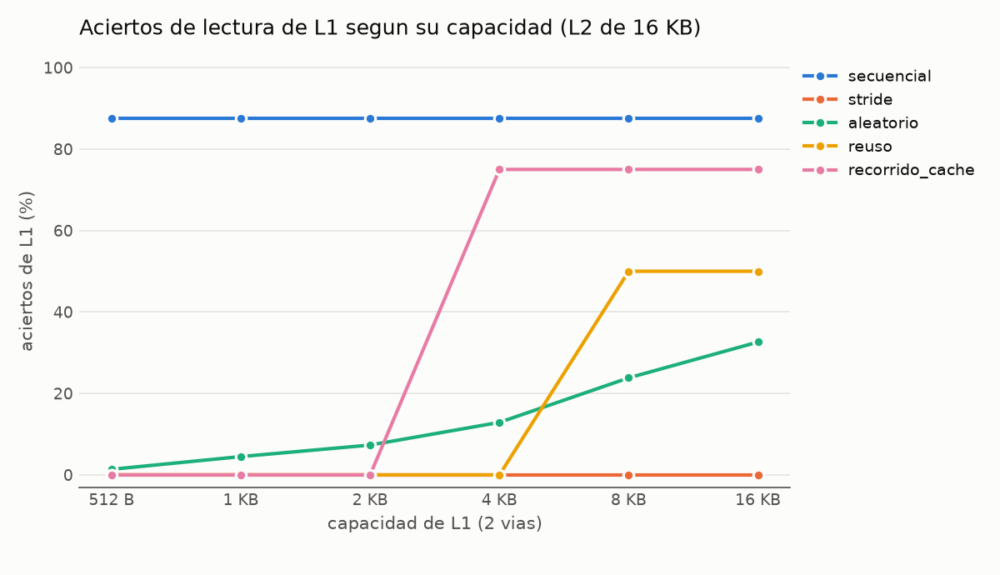
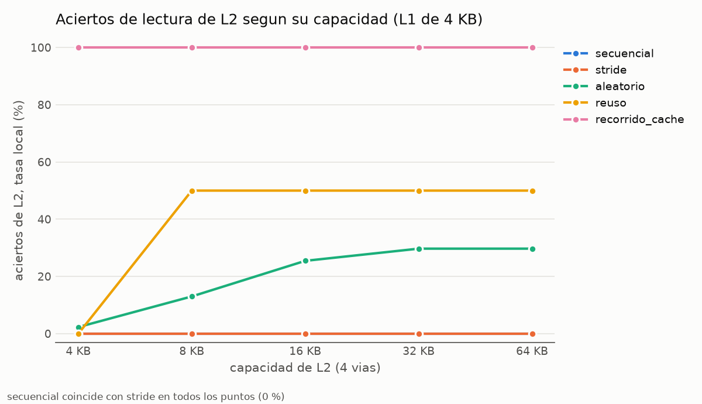
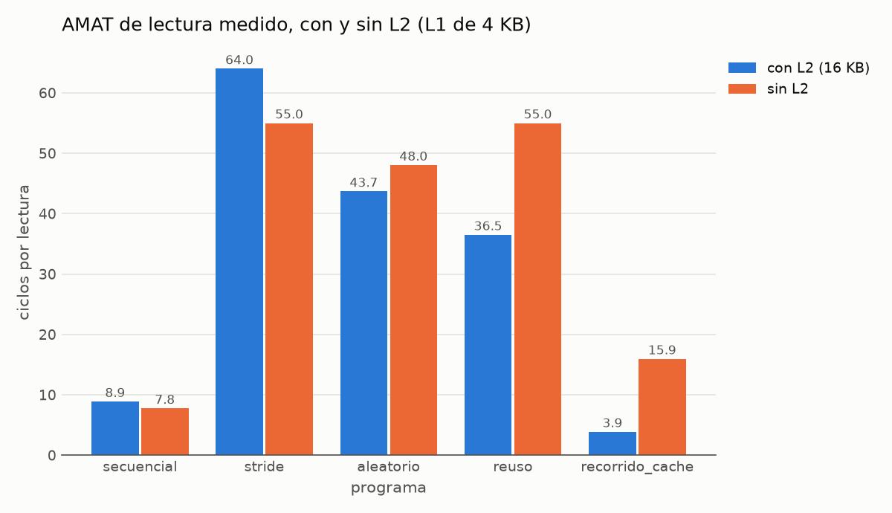
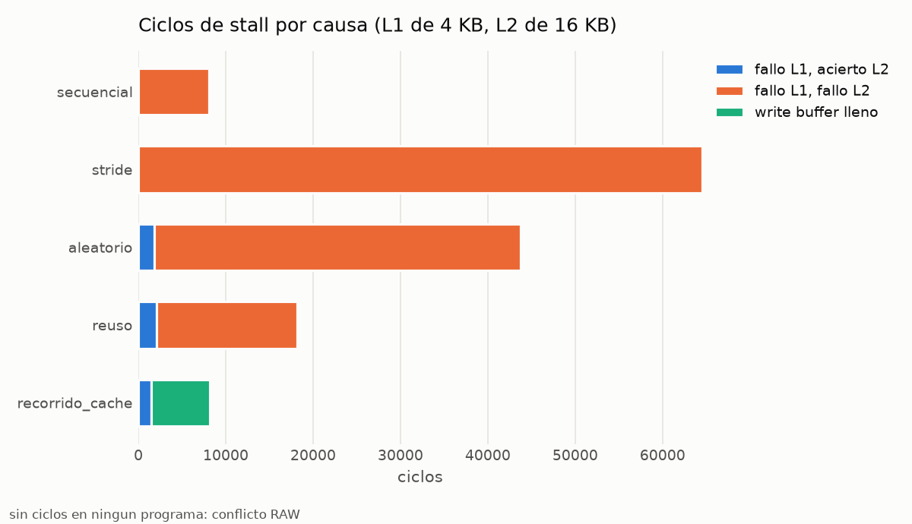

# Análisis de rendimiento y validación

CE-4301 Arquitectura de Computadores I · Proyecto Grupal II · Grupo #4 · CERBERO-1

Sección 3 de la documentación de diseño: metodología de medición, contadores, benchmarks, análisis de resultados, comparación entre configuraciones y justificación de las decisiones.

Complementos: [jerarquia-memoria.md](jerarquia-memoria.md) (políticas) y [organizacion.md](organizacion.md) (microarquitectura). El análisis por nivel de optimización del compilador está en [ITERACION5_NIVELES.md](../../documentacion/ITERACION5_NIVELES.md) y se resume en la §12.

**Qué viene de cuándo.** Las secciones 4 a 6 son la medición de la Iteración 3, con L1-D directo a memoria principal; se conservan porque fijan la línea base y sus conclusiones siguen en pie. Todo lo demás es de la Iteración 5, con la jerarquía completa (L1-D + L2 + memoria), y sale del barrido de `barrido/jerarquia/`:

```bash
cd src/build
make analisis          # 11 configuraciones x 14 programas, unos 6 minutos
make tablas-analisis   # solo rehace barrido/jerarquia/tablas.md y los gráficos
```

---

## 1. Metodología

**Los contadores están en el hardware.** Las métricas las produce `perf_counters.sv`, un módulo RTL dentro de `top.sv`, no un testbench que observa señales internas. La diferencia no es de estilo: un testbench que calcula la tasa de aciertos mirando `dut.u_l1d.acierto` mide su propia interpretación del diseño, y si está mal el número sale mal sin que nada avise. Los contadores reciben pulsos que la caché emite por puertos dedicados y son lo que un procesador real reportaría. No tienen salida hacia el datapath, así que medir no puede cambiar lo medido.

**Por qué no se usó `perf` de Linux.** El profesor pidió revisarlo. No puede medir este sistema, corra o no en WSL, y la razón es qué mide: `perf` instrumenta el procesador del anfitrión, y lo que el anfitrión ejecuta es `vvp`, el simulador. Reportaría los fallos de caché del Intel o AMD de la máquina mientras interpreta el netlist, no los de CERBERO-1. Son dos jerarquías distintas y la que ve es la equivocada. Para el procesador simulado el instrumento correcto son contadores dentro del diseño, que es lo que un procesador real también lleva (los PMU del ARM, el `rdpmc` del x86). `perf` sí serviría para medir el compilador NOVA, que es un programa nativo.

**Qué cuenta como qué.**

| Métrica | Definición exacta | Por qué así |
|---|---|---|
| ciclos | del reset a `HALT` | no incluye los ciclos del arnés esperando el drenado |
| bundles | los que **avanzaron**, no los que estuvieron | un bundle congelado 53 ciclos cuenta una vez, no 54 |
| instrucciones | operaciones no-NOP despachadas | cinco por bundle como máximo |
| IPC | instrucciones / ciclos | mezcla el costo del programa con el de la memoria (ver §11) |
| aciertos / fallos | un pulso por acceso, en su ciclo | un fallo que espera 53 ciclos cuenta un fallo, no 53 |
| ciclos de stall | un pulso por ciclo perdido, con su causa | así la suma de causas tiene que dar el total |
| stall por fallo de L1, separado según L2 | los ciclos de cada fallo de L1 se asignan al terminar el relleno, según si esa lectura llegó a memoria principal | es lo que permite medir la penalidad de un acierto y de un fallo de L2 por separado (§9) |
| AMAT de lectura | 1 + ciclos de stall por fallo de lectura / lecturas | solo lecturas: un store no espera, así que meterlo en el promedio lo diluye |

Los 31 contadores son de 32 bits, **saturan** en vez de envolver, y levantan un bit pegajoso si alguno saturó. Un contador que envuelve en silencio produce un informe plausible y falso.

---

## 2. Cómo se validan los números

Tres mecanismos independientes, porque un contador correcto sobre un diseño mal entendido sigue dando un número falso.

**2.1 La suma de causas tiene que dar el total.** `ciclos_stall` lo cuenta un contador y cada causa (fallo de lectura, write buffer lleno, conflicto RAW, eviction buffer lleno) otro, por caminos distintos. A su vez, el stall por fallo de lectura tiene que ser la suma de la parte que acertó en L2 y la que falló. `tb_programa.sv` compara las dos igualdades en cada corrida, y el barrido se detiene si alguna da `FALLA`. En las 154 corridas da `ok`.

**2.2 Benchmarks cuyos contadores se calculan a mano.** Es el mecanismo central y responde a lo que el profesor pidió: validar que las métricas son reales.

`recorrido_cache.s` recorre 128 líneas consecutivas en ciclo, con paso de 32 bytes para tocar una línea por acceso, y repite el recorrido cuatro veces. Su conjunto de trabajo es de 4 KB, el tamaño exacto de L1-D, que tiene capacidad para 128 líneas. Entonces los contadores **solo pueden dar** estos valores:

| Contador | Exigido | De dónde sale, sin simular |
|---|---|---|
| fallos de lectura | 128 | la pasada 1 toca cada línea por primera vez: solo fallos de arranque |
| aciertos de lectura | 384 | las pasadas 2, 3 y 4 completas (128 × 3), porque el conjunto cabe justo |
| aciertos de escritura | 0 | con no-write-allocate ningún store trae su línea, así que ninguno acierta |
| fallos de escritura | 130 | los 128 de la pasada de escritura más los 2 del guardado final |

`tb_ejemplos.sv` compara los cuatro contra el hardware y también los datos (la suma 4 × (0+1+...+127) = 32512), porque un contador correcto sobre un cálculo equivocado no prueba nada. Si la caché acertara de más, el LRU estaría conservando líneas que debió expulsar; si de menos, estaría expulsando líneas que caben.

La Iteración 5 agrega oráculos del mismo tipo: los patrones secuencial, stride y reuso tienen sus contadores calculados a mano, y `tb_patrones.sv` los exige exactos, incluidos los aciertos y fallos de L2 de `patron_reuso` (§11.1).

**2.3 Los testbenches.**

| Unidad | Qué fija |
|---|---|
| `tb_perf_counters` | que cada contador cuente su evento y ninguno más, que la saturación avise, y que el stall de cada fallo de L1 se asigne a acierto o fallo de L2 sin arrastrar la marca al fallo siguiente |
| `tb_l1_dcache` | aciertos, fallos, orden de expulsión del LRU, las causas de stall y la invalidación hacia atrás |
| `tb_l2_cache` | aciertos, write-allocate con escritura parcial y de línea completa, LRU por edades con cualquier número de vías |
| `tb_mem_system` | que T_mem medido contra el RTL sea 53, y la regresión de la carrera de fusión |
| `tb_eviction_buffer` | FIFO, fusión, conflicto RAW, fusión sobre línea en vuelo |
| `tb_ejemplos` | programas completos contra sus valores esperados |
| `tb_patrones` | los cuatro patrones de la Iteración 5 contra su oráculo, con y sin L2 |

`make all` corre las 40 unidades; un caso que falla termina en `$fatal`, así que `make` en verde quiere decir cero fallos.

---

## 3. Los benchmarks

**Del Proyecto I y la Iteración 3.** Los diez primeros vienen del Proyecto I y entran sin recompilarse, lo cual es parte del resultado: la jerarquía se agregó sin tocar la ISA.

| Programa | Qué ejercita | Accesos |
|---|---|---|
| `recorrido_cache.s` | 128 líneas × 4 pasadas sobre 4 KB; satura el write buffer | 642 |
| `lazo_estres.s` | 900 009 ciclos, cinco slots ocupados, localidad perfecta | 300 000 |
| `suma_simple_emp.s` / `suma_vliw_emp.s` | el mismo cálculo sin y con trabajo independiente | 65 cada uno |
| `fibonacci.s` | aritmética encadenada al límite de la latencia; 47 stores, cero lecturas | 47 |
| `div32_prueba.s` | subrutina de división con enlace y retorno | 24 |
| `estadisticas.s` | seis estadísticas sobre ocho palabras, llama a `__div32` | 14 |
| `feistel.s` | la unidad criptográfica y la bóveda | 12 |
| `contar_hasta_n.s` | el lazo mínimo del manual | 11 |
| `sesion_sin_logout.s` | el cierre automático de sesión | 3 |
| `suma_10_15.s` | el caso trivial, sin accesos a memoria | 0 |

**Por qué hubo que escribir `recorrido_cache.s`.** El primer barrido, con los diez del Proyecto I y seis capacidades de L1 de 512 B a 16 KB, **salió completamente plano**: esos programas tocan dos o tres líneas cada uno, así que todos sus fallos son de arranque y ninguna caché más grande los salva. Un barrido plano no es un resultado sobre la caché sino sobre los benchmarks.

**Los patrones de la Iteración 5.** El enunciado (§7.1.5) pide patrones secuencial, aleatorio y stride. Se agregó un cuarto, de reuso, porque los otros tres no pueden distinguir a la L2 (ver abajo).

| Programa | Lecturas | Paso | Qué toca | Qué mide |
|---|---|---|---|---|
| `patron_secuencial.s` | 1024 | 4 B | 128 líneas (4 KB), ocho lecturas por línea | localidad espacial máxima |
| `patron_stride.s` | 1024 | 32 B | 1024 líneas (32 KB), una vez cada una | sin localidad de ningún tipo |
| `patron_aleatorio.s` | 1024 | al azar | ~650 de 1024 líneas (32 KB) | localidad temporal accidental |
| `patron_reuso.s` | 512 | 32 B | 256 líneas (8 KB), dos pasadas | reuso a una distancia que L1 no cubre y L2 sí |

El paso del stride es exactamente el tamaño de línea, lo que anula la localidad espacial. El aleatorio recorre **la misma región de 32 KB que el stride**, así que la única diferencia entre ellos es el orden.

**Por qué hizo falta el de reuso.** El secuencial y el stride tocan cada línea una sola vez: todo fallo de L1 es de arranque y también falla en L2. Para que la L2 sirva hace falta volver a una línea que L1 ya expulsó. `patron_reuso.s` recorre 8 KB dos veces: el doble de la L1 y la mitad de la L2. En L1 las 256 líneas caen 4 por conjunto en 2 vías, y con LRU sobre un recorrido cíclico ninguna sobrevive hasta la segunda pasada. En L2 caben todas.

El barrido deja fuera a `lazo_estres.s`: son 900 000 ciclos por corrida, y su patrón (100 % de aciertos en cualquier geometría) no distingue configuraciones.

---

## 4. Línea base del VLIW (Iteración 3)

| Programa | Ciclos | Bundles | Instr. | IPC bundles | Ocupación | Vacíos | Delay desp. |
|---|---|---|---|---|---|---|---|
| `contar_hasta_n.s` | 99 | 99 | 76 | 0,768 | 0,77 | 56 % | 9 |
| `div32_prueba.s` | 4244 | 4138 | 2563 | 0,604 | 0,62 | 52 % | 198 |
| `estadisticas.s` | 864 | 811 | 567 | 0,656 | 0,70 | 50 % | 33 |
| `feistel.s` | 149 | 43 | 29 | 0,195 | 0,67 | 35 % | 2 |
| `fibonacci.s` | 382 | 382 | 381 | 0,997 | 1,00 | 62 % | 46 |
| `lazo_estres.s` | 900 117 | 900 009 | 1 400 010 | 1,555 | 1,56 | 56 % | 99 999 |
| `recorrido_cache.s` | 17 706 | 5171 | 3872 | 0,219 | 0,75 | 62 % | 638 |
| `sesion_sin_logout.s` | 34 | 34 | 25 | 0,735 | 0,74 | 44 % | 2 |
| `suma_10_15.s` | 7 | 7 | 4 | 0,571 | 0,57 | 43 % | 0 |
| `suma_simple_emp.s` | 1007 | 583 | 453 | 0,450 | 0,78 | 45 % | 63 |
| `suma_vliw_emp.s` | 677 | 253 | 267 | 0,394 | 1,06 | 22 % | 15 |

1. **Sin accesos a memoria el pipeline despacha un bundle por ciclo.** `fibonacci.s` da 0,997 (los tres ciclos que faltan son el llenado). Eso confirma que el "ideal" de la sección 6 es la cuenta de bundles, y que todo lo que sobre es costo de memoria.
2. **Los bundles están casi vacíos: entre 22 % y 62 % son NOP puros.** El profesor señaló que deberían usar su capacidad completa, y el número es que la ocupación va de 0,6 a 1,1 operaciones de las cinco ranuras. No es un defecto del procesador sino la medida de lo que el compilador tiene por ganar. El empaquetador ya se nota: `suma_vliw_emp.s` tiene 22 % de vacíos y ocupación 1,06, contra 45 % y 0,78 de la versión escalar del mismo cálculo.
3. **Los delay slots se desperdician casi siempre.** `lazo_estres.s` desperdicia 99 999 de 100 000, y cada uno aprovechado es un ciclo.

---

## 5. La caché L1-D (Iteración 3)

Geometría: 4 KB, 2 vías, 64 conjuntos, líneas de 32 B, write-through, no-write-allocate, LRU. Sin L2: cada fallo va a memoria principal. El AMAT de esta tabla es sobre todos los accesos, como se definía entonces; desde la Iteración 5 se reporta solo sobre lecturas (§1).

| Programa | Accesos | ld hit | ld miss | st miss | Aciertos | AMAT | Stall: miss / wb / RAW |
|---|---|---|---|---|---|---|---|
| `lazo_estres.s` | 300 000 | 99 999 | 1 | 1 | **100,0 %** | 1,00 | 107 / 0 / **1** |
| `suma_simple_emp.s` | 65 | 56 | 8 | 1 | 86,2 % | 8,34 | 424 / 0 / 0 |
| `suma_vliw_emp.s` | 65 | 56 | 8 | 1 | 86,2 % | 8,34 | 424 / 0 / 0 |
| `feistel.s` | 12 | 8 | 2 | 2 | 66,7 % | 18,67 | 106 / 0 / 0 |
| `recorrido_cache.s` | 642 | 384 | 128 | 130 | 59,8 % | 24,55 | 7500 / **5035** / 0 |
| `estadisticas.s` | 14 | 7 | 1 | 6 | 50,0 % | 27,50 | 53 / 0 / 0 |
| `div32_prueba.s` | 24 | 10 | 2 | 12 | 41,7 % | 31,92 | 106 / 0 / 0 |
| `contar_hasta_n.s` | 11 | 0 | 0 | 11 | 0,0 % | 1,00 | 0 / 0 / 0 |
| `fibonacci.s` | 47 | 0 | 0 | 47 | 0,0 % | 1,00 | 0 / 0 / 0 |
| `sesion_sin_logout.s` | 3 | 0 | 0 | 3 | 0,0 % | 1,00 | 0 / 0 / 0 |

**Las tres tasas de 0,0 % no son un defecto.** `fibonacci.s`, `contar_hasta_n.s` y `sesion_sin_logout.s` solo escriben, nunca leen, y con no-write-allocate ningún store puede acertar, así que 0 % es el único valor posible. Su AMAT de 1,00 dice la verdad: ninguno pierde un solo ciclo, porque los stores no esperan.

---

## 6. Contra la línea base sin caché (Iteración 3)

La Iteración 2 proyectó dos cotas antes de que la caché existiera: la **optimista** (solo los loads pagan los 53 ciclos) y la **pesimista** (todo acceso los paga).

| Programa | Ideal | Medido | Sobrec. | Optimista | Pesimista | Gana |
|---|---|---|---|---|---|---|
| `contar_hasta_n.s` | 99 | 99 | 1,00× | 99 | 671 | 6,8× |
| `div32_prueba.s` | 4138 | 4244 | 1,03× | 4762 | 5386 | 1,3× |
| `estadisticas.s` | 811 | 864 | 1,07× | 1227 | 1539 | 1,8× |
| `feistel.s` | 43 | 149 | 3,47× | 563 | 667 | 4,5× |
| `fibonacci.s` | 382 | 382 | 1,00× | 382 | 2826 | 7,4× |
| `lazo_estres.s` | 900 009 | 900 117 | 1,00× | 6 100 009 | 16 500 009 | 18,3× |
| `recorrido_cache.s` | 5171 | 17 706 | 3,42× | 31 795 | 38 555 | 2,2× |
| `sesion_sin_logout.s` | 34 | 34 | 1,00× | 34 | 190 | 5,6× |
| `suma_10_15.s` | 7 | 7 | 1,00× | 7 | 7 | 1,0× |
| `suma_simple_emp.s` | 583 | 1007 | 1,73× | 3911 | 3963 | 3,9× |
| `suma_vliw_emp.s` | 253 | 677 | 2,68× | 3581 | 3633 | 5,4× |
| **total** | **911 530** | **925 286** | **1,02×** | **6 146 370** | **16 557 446** | **17,9×** |

**Los 11 programas quedaron por debajo de la cota optimista**, que era el mejor caso posible sin jerarquía. La sobrecarga total sobre el ideal es de **1,02×**: con memoria de 53 ciclos el sistema corre a un 2 % del costo de una memoria imaginaria de un ciclo.

### El hallazgo que vale llevar a la defensa

La Iteración 2 predijo que la latencia de memoria comprime la ventaja del VLIW, y la Iteración 3 lo confirmó:

| | Escalar | VLIW | Ganancia |
|---|---|---|---|
| Ideal (memoria de un ciclo) | 583 bundles | 253 bundles | **2,30×** |
| Medido (memoria de 53 ciclos) | 1007 ciclos | 677 ciclos | **1,49×** |

Se pierde el 35 % de la ventaja, porque los 424 ciclos de stall por fallo de lectura son **los mismos en las dos versiones**: empaquetar instrucciones reduce los bundles, no los accesos a memoria. Esperar la memoria no se paraleliza. La Iteración 5 lo confirmó desde el compilador: de los ciclos que ahorra `-O2`, el 91,5 % viene de emitir menos operaciones y solo el 8,5 % de empaquetar mejor (§12).

---

## 7. Capacidad de L1 y de L2

El barrido de la Iteración 5 varía la capacidad de cada nivel dejando el otro en su valor base (L1 de 4 KB a 2 vías, L2 de 16 KB a 4 vías). Los cinco programas de esta sección son los únicos que separan configuraciones; el secuencial y el stride salen planos en todas, por la razón de §3.



### 7.1 Capacidad de L1, con L2 de 16 KB

| Programa | 512 B | 1 KB | 2 KB | **4 KB** | 8 KB | 16 KB |
|---|---|---|---|---|---|---|
| `recorrido_cache` aciertos L1 | 0,00 % | 0,00 % | 0,00 % | **75,00 %** | 75,00 % | 75,00 % |
| `recorrido_cache` ciclos | 16 384 | 16 384 | 16 384 | **13 312** | 13 312 | 13 312 |
| `patron_reuso` aciertos L1 | 0,00 % | 0,00 % | 0,00 % | **0,00 %** | 50,00 % | 50,00 % |
| `patron_reuso` ciclos | 22 301 | 22 301 | 22 301 | **22 301** | 20 253 | 20 253 |
| `patron_aleatorio` aciertos L1 | 1,37 % | 4,49 % | 7,32 % | **12,89 %** | 23,83 % | 32,62 % |
| `patron_aleatorio` ciclos | 80 506 | 80 250 | 80 018 | **79 562** | 78 831 | 78 056 |

**1. Cada patrón tiene su codo, y está donde su conjunto de trabajo cabe.** `recorrido_cache` (4 KB) salta de 0 % a 75 % al llegar a 4 KB; `patron_reuso` (8 KB) salta de 0 % a 50 % al llegar a 8 KB. Entre codos la curva es plana, sin degradación gradual: es el peor caso del LRU con un recorrido cíclico que no cabe, y la medición lo reproduce exacto. El aleatorio, que no tiene un conjunto de trabajo definido, sube de forma gradual.

**2. Con L2, quedarse corto de L1 cuesta mucho menos.** En la Iteración 3, sin L2, el mismo codo de `recorrido_cache` ahorraba el 44,72 % de los ciclos del barrido. Ahora ahorra el **18,75 %** (16 384 a 13 312), porque con L1 de 2 KB sus 512 fallos de lectura aciertan todos en L2 y pagan 8 ciclos en vez de 54. En `patron_reuso`, duplicar la L1 a 8 KB ahorra el 9,18 %; en el aleatorio, cuadruplicarla a 16 KB ahorra el 1,9 %. **La L2 amortigua la elección de tamaño de L1**: su capacidad deja de ser la decisión crítica.

**3. Por qué 4 KB sigue siendo la elección.** Es el codo del único patrón con conjunto de trabajo de 4 KB, y pasarse a 8 KB solo ayuda a un patrón escrito para necesitar 8 KB, con un 9 % de ganancia. Además, con inclusión, agrandar L1 no agranda la jerarquía (§10).

### 7.2 Capacidad de L2, con L1 de 4 KB



| Programa | 4 KB | 8 KB | **16 KB** | 32 KB | 64 KB | sin L2 |
|---|---|---|---|---|---|---|
| `patron_aleatorio` aciertos L2 | 2,30 % | 13,00 % | **25,45 %** | 29,71 % | 29,71 % | n/a |
| `patron_aleatorio` ciclos | 92 152 | 85 667 | **79 562** | 77 472 | 77 472 | 84 019 |
| `patron_reuso` aciertos L2 | 0,00 % | 50,00 % | **50,00 %** | 50,00 % | 50,00 % | n/a |
| `patron_reuso` ciclos | 36 381 | 22 301 | **22 301** | 22 301 | 22 301 | 31 773 |
| `recorrido_cache` ciclos | 13 312 | 13 312 | **13 312** | 13 312 | 13 312 | 17 859 |

**1. Una L2 del tamaño de la L1 es peor que no tener L2.** Con 4 KB, `patron_reuso` tarda 36 381 ciclos contra 31 773 sin L2, y el aleatorio 92 152 contra 84 019. Con inclusión, una L2 de 4 KB solo puede guardar lo que ya está en L1, así que casi nunca acierta (0 % y 2,30 %) y cada fallo paga los 8 ciclos de consultarla para nada. Además provoca invalidaciones que le quitan aciertos a L1 (§10).

**2. El aleatorio satura en 32 KB, que es su región.** De 32 a 64 KB no cambia nada: el 29,71 % es todo el reuso que tiene el programa, y el resto de sus fallos son de arranque (primeras visitas a cada línea).

**3. Por qué 16 KB.** Para el aleatorio, 16 KB captura el **86 %** de la ganancia que se puede obtener entre 4 y 64 KB (12 590 de 14 680 ciclos). Pasar a 32 KB ahorra otro 2,6 % con el doble de silicio. `patron_reuso` y `recorrido_cache` ya están en su mejor valor desde 8 KB. 16 KB es el primer tamaño que deja a la L2 cuatro veces más grande que la L1, que es la relación con la que la inclusión deja de costar (§10).

---

## 8. Con L2 contra sin L2

La configuración `sin_l2` es el mismo RTL compilado con `-DCERBERO_SIN_L2`: el árbitro habla directo con memoria principal. Así la comparación aísla el aporte de la L2 y no compara dos modelos distintos.



| Programa | Ciclos con L2 | Ciclos sin L2 | Aceleración | IPC con L2 | IPC sin L2 | AMAT con L2 | AMAT sin L2 | Aciertos L2 |
|---|---|---|---|---|---|---|---|---|
| `patron_secuencial` | 16 266 | 15 114 | **0,93×** | 0,378 | 0,407 | 8,88 | 7,75 | 0,00 % |
| `patron_stride` | 72 714 | 63 498 | **0,87×** | 0,085 | 0,097 | 64,00 | 55,00 | 0,00 % |
| `patron_aleatorio` | 79 562 | 84 019 | **1,06×** | 0,180 | 0,171 | 43,69 | 48,04 | 25,45 % |
| `patron_reuso` | 22 301 | 31 773 | **1,42×** | 0,138 | 0,097 | 36,50 | 55,00 | 50,00 % |
| `recorrido_cache` | 13 312 | 17 859 | **1,34×** | 0,291 | 0,217 | 3,88 | 15,95 | 100,00 % |

**1. La L2 no es gratis: cada fallo que llega a memoria paga 9 ciclos más.** Sin L2, un fallo de L1 cuesta 54 ciclos (53 de T_mem más 1 del árbitro). Con L2, uno que también falla en L2 cuesta **63** (8 de consultarla, 53 de memoria y 2 de instalar la línea). Por eso el secuencial y el stride, cuyos fallos son todos de arranque, tardan con L2 un 7,6 % y un 14,5 % más de ciclos.

**2. Cuándo compensa, en una cuenta.** Con L2, un fallo de L1 cuesta en promedio `8 + m_L2 × 55`; sin L2 cuesta 54. La L2 gana si `m_L2 < 46/55`, es decir **si acierta más del 16,4 % de los fallos de L1**. El aleatorio, con 25,45 %, queda por encima y gana poco (1,06×); el reuso, con 50 %, gana 1,42×; `recorrido_cache`, que acierta el 100 % de sus lecturas en L2, gana 1,34×.

**3. El IPC cuenta la misma historia.** El binario es el mismo con y sin L2, así que la razón de IPC es exactamente la aceleración: 0,138 contra 0,097 en el reuso es el mismo 1,42×. El IPC no agrega información aquí; sirve para comparar contra la línea base del VLIW (§4), no entre configuraciones.

**4. La L2 baja el tráfico a memoria donde hay reuso.** `patron_reuso` hace 258 transferencias de línea con L2 contra 513 sin ella, y el aleatorio 667 contra 893. El uso del bus baja con L2 en los 13 programas que tocan memoria (en `patron_reuso`, de 83,81 % a 59,48 %), incluso en los que se vuelven más lentos.

**5. Por qué `recorrido_cache` gana tanto si su L1 ya acierta 75 %.** Sus 128 fallos de lectura son de líneas que el programa acaba de escribir. Con L2 write-allocate, esas escrituras ya trajeron las líneas a L2, así que cada fallo de lectura acierta en L2. El desglose del stall lo muestra entero:

| Causa | Sin L2 | Con L2 | Diferencia |
|---|---|---|---|
| Fallo de lectura | 7652 | 1476 | −6176 |
| Eviction buffer lleno | 5959 | 0 | −5959 |
| Write buffer lleno | 5036 | 6665 | +1629 |
| **Total** | **12 688** | **8141** | **−4547** |

Sin L2, cada store baja directo al eviction buffer y lo llena. Con L2 write-back, los stores se quedan sucios en la L2 y el eviction buffer no se usa hasta el final. El precio de write-allocate se ve en el write buffer: cada línea que drena falla en L2 y obliga a traerla de memoria antes de escribirla, lo que cuesta 1629 ciclos más. El balance es de 4547 ciclos a favor, exactamente la diferencia entre 17 859 y 13 312.

**6. Los programas del Proyecto I casi no la notan.** Tocan dos o tres líneas cada uno, así que no hay reuso que la L2 pueda atrapar. Van de 0,89× (`feistel`, con dos fallos de lectura que pagan 63 en vez de 54) a 1,01× (`div32_prueba`), y los que no leen memoria dan 1,00× exacto.

---

## 9. AMAT de dos niveles y stalls por tipo de fallo

El AMAT de lectura con dos niveles es:

```
AMAT = T_L1 + m_L1 × (T_L2 + m_L2 × (T_mem + 2))
     = 1    + m_L1 × (8    + m_L2 × 55)
```

con `m_L2` la tasa de fallos **local** (fallos de L2 / lecturas que llegan a L2). Los 2 ciclos sobre T_mem son `L2_MISS_EXTRA`, el costo de instalar la línea en L2 antes de devolverla; no se supusieron, se midieron fallo por fallo.

| Programa | m_L1 | m_L2 local | AMAT teórico | AMAT medido | Penalidad, acierto L2 | Penalidad, fallo L2 |
|---|---|---|---|---|---|---|
| `patron_secuencial` | 12,50 % | 100,00 % | 8,88 | 8,88 | n/a | 63,0 |
| `patron_stride` | 100,00 % | 100,00 % | 64,00 | 64,00 | n/a | 63,0 |
| `patron_aleatorio` | 87,11 % | 74,55 % | 43,69 | 43,69 | 8,0 | 63,0 |
| `patron_reuso` | 100,00 % | 50,00 % | 36,50 | 36,50 | 8,0 | 63,0 |
| `recorrido_cache` | 25,00 % | 0,00 % | 3,00 | **3,88** | **11,5** | n/a |

**1. En los cuatro patrones la fórmula y el hardware coinciden al centésimo.** La penalidad de un acierto de L2 es 8,0 ciclos y la de un fallo 63,0, exactas, en todos los programas que las tienen. Eso confirma dos cosas a la vez: que la L2 tiene el hit time de diseño (8 ciclos, `L2_HIT_CYCLES`) y que los contadores separan bien los dos tipos de fallo, porque la penalidad de cada tipo sale de dividir dos contadores distintos.

**2. Donde no coinciden, la diferencia es el write buffer.** En `recorrido_cache` el AMAT medido es 3,88 y el teórico 3,00. La penalidad de sus aciertos en L2 da 11,5 en lugar de 8: de sus 128 fallos, 120 cuestan 8 ciclos y 8 cuestan entre 61 y 65, porque llegan cuando el árbitro está drenando el write buffer hacia la L2 y tienen que esperar su turno. La fórmula no modela esa contención y el contador sí la ve. Es el mismo efecto que la Iteración 3 encontró sin L2 (58,6 ciclos medidos contra 53 de T_mem): un costo real de write-through que solo aparece bajo presión del buffer.



| Programa | Fallo L1, acierto L2 | Fallo L1, fallo L2 | Write buffer lleno | Conflicto RAW | Total |
|---|---|---|---|---|---|
| `patron_secuencial` | 0 | 8064 | 0 | 0 | 8064 |
| `patron_stride` | 0 | 64 512 | 0 | 0 | 64 512 |
| `patron_aleatorio` | 1816 | 41 895 | 0 | 0 | 43 711 |
| `patron_reuso` | 2048 | 16 128 | 0 | 0 | 18 176 |
| `recorrido_cache` | 1476 | 0 | **6665** | 0 | 8141 |

**3. Un acierto de L2 cuesta casi ocho veces menos que un fallo, y aun así los fallos dominan.** En el aleatorio, la L2 atrapa una cuarta parte de los fallos de L1 (227), pero esos aciertos suman 1816 ciclos contra 41 895 de los fallos. En el reuso, 256 aciertos de L2 cuestan 2048 ciclos y 256 fallos cuestan 16 128. **Lo que más baja el stall no es acertar más en L2 sino ir menos a memoria.**

**4. En `recorrido_cache` el cuello de botella no es la caché sino el write buffer**: el 82 % de su stall (6665 de 8141) es buffer lleno. Ninguna capacidad de L1 o L2 lo mueve (§7, los ciclos son iguales en todas). Es el límite de write-through cuantificado: un programa que escribe 128 líneas distintas seguidas satura cualquier profundidad.

**5. El stall por RAW es cero en las 154 corridas,** y el de eviction buffer lleno es cero en las 140 con L2. Las dos decisiones que los sostienen (stall en lugar de forwarding y 8 entradas en el eviction buffer) se discuten en §13.

---

## 10. Lo que cuesta la inclusión

La sección 5.2 del enunciado pide contar las invalidaciones hacia atrás ejecutadas sobre L1-D, para cuantificar el costo de la política inclusiva sobre el hit rate. La justificación de la política está en [jerarquia-memoria.md](jerarquia-memoria.md) D6; aquí está lo medido.

| Relación L2 / L1 | Configuraciones del barrido | Invalidaciones ejecutadas |
|---|---|---|
| 4× o más | base (16 KB / 4 KB), L2 de 32 y 64 KB, L1 de 512 B a 2 KB | **0** en los 14 programas |
| 2× | L2 de 8 KB; L1 de 8 KB | 0, salvo 2 en `patron_aleatorio` con L1 de 8 KB |
| 1× | L2 de 4 KB | stride 897, aleatorio 404, reuso 385, secuencial 1, recorrido 1 |
| 1× | L1 de 16 KB | stride 513, aleatorio 111 |

**1. Con la geometría del proyecto, la inclusión cuesta cero.** La L2 tiene 512 líneas y la L1 128: cuando la L2 elige una víctima, casi nunca es algo que la L1 todavía tenga. El costo aparece cuando los dos niveles tienen el mismo tamaño, y ahí sí se ve en el hit rate: con L2 de 4 KB, `patron_aleatorio` pasa de 132 a 112 aciertos de L1 (de 12,89 % a 10,94 %), veinte aciertos que la L2 le obligó a soltar.

**2. La capacidad útil de una jerarquía inclusiva es la de L2, no la suma.** En `patron_aleatorio` con L2 de 16 KB, agrandar L1 de 4 a 8 y a 16 KB da 359, 356 y 357 aciertos entre los dos niveles, y 665 a 668 fallos de L2. Los aciertos se mueven de L2 a L1 (de 227 a 23 en L2) pero el total no crece, porque todo lo que está en L1 tiene que estar también en L2. Es la razón de fondo de que una L1 de 16 KB no aporte casi nada con esta L2 (§7.1) y de que la L2 tenga que ser varias veces más grande que la L1.

**3. Lo que no se midió.** Para saber cuánto más acertaría la jerarquía con NINE haría falta implementarla. Con la relación 4× del proyecto, las cero invalidaciones dicen que la diferencia no se vería: NINE solo ganaría donde la inclusión invalida algo, y aquí no invalida nada.

---

## 11. Iteración 5: patrones de acceso a memoria

La sección 7.1.5 del enunciado pide evaluar el sistema con benchmarks de distintos patrones de acceso, correlacionando hit rates, IPC, stalls y AMAT con las decisiones de diseño. Los programas se describen en §3; esta sección es la configuración base (L1 de 4 KB, L2 de 16 KB).

### 11.1 Oráculos exactos

Tres de los cuatro patrones tienen contadores calculables sin simular. `tb_patrones.sv` exige exactos los de L1 en los tres y los de L2 en el reuso; los de L2 del secuencial y el stride salen iguales a la cuenta en el informe, pero ninguna prueba los fija:

| Patrón | Fallos L1 | Aciertos L1 | Fallos L2 | Aciertos L2 | De dónde sale |
|---|---|---|---|---|---|
| secuencial | 128 | 896 | 128 | 0 | un fallo por línea, siete aciertos gratis; toda línea es nueva |
| stride | 1024 | 0 | 1024 | 0 | cada lectura estrena línea |
| reuso | 512 | 0 | 256 | 256 | ninguna línea sobrevive en L1 entre pasadas; en L2 caben las 256 |

Los 256 aciertos de L2 de `patron_reuso` solo salen si el LRU por edades de la L2 conserva exactamente las líneas que caben, del mismo modo que los 384 aciertos de `recorrido_cache` validan el LRU de la L1. También se exige que haya cero invalidaciones: con 8 KB dentro de una L2 de 16 KB, la L2 no expulsa nada.

### 11.2 Resultados

| | Secuencial | Aleatorio | Stride | Reuso |
|---|---|---|---|---|
| Lecturas | 1024 | 1024 | 1024 | 512 |
| **Tasa de aciertos L1** | **87,50 %** | **12,89 %** | **0,00 %** | **0,00 %** |
| Tasa de aciertos L2 (local, lecturas) | 0,00 % | **25,45 %** | 0,00 % | **50,00 %** |
| **AMAT de lectura** | **8,88** | **43,69** | **64,00** | **36,50** |
| Ciclos | 16 266 | 79 562 | 72 714 | 22 301 |
| Ciclos de stall | 8064 | 43 711 | 64 512 | 18 176 |
| IPC | 0,378 | 0,180 | 0,085 | 0,138 |
| Accesos a memoria principal | 130 | 667 | 1026 | 258 |
| Utilización del bus | 40,60 % | 43,45 % | 72,86 % | 59,48 % |
| Aceleración contra sin L2 | 0,93× | 1,06× | 0,87× | 1,42× |

### 11.3 Qué dicen estos números

**1. El patrón vale 4,5 veces en tiempo, con el mismo trabajo.** Secuencial y stride ejecutan el mismo número de bundles (8202) y las mismas instrucciones (6150): son el mismo programa con otro paso. Uno tarda 16 266 ciclos y el otro 72 714. Toda la diferencia son los 56 448 ciclos de stall adicionales, es decir memoria.

**2. La decisión de línea de 32 bytes se valida sola.** El secuencial acierta 87,50 %, que es exactamente 7/8: un fallo trae ocho palabras y las siete siguientes salen gratis. Y el stride, con paso igual a la línea, da 0,00 %: la misma decisión que le regala siete aciertos a uno le da cero al otro. **El tamaño de línea es una apuesta a la localidad espacial, y aquí se ve ganada y perdida en el mismo experimento.**

**3. La L2 solo sirve donde hay reuso, y la medición lo aísla.** La L2 atrapa el 25,45 % de los fallos de L1 en el aleatorio, el 50 % en el reuso, y **0,00 % en el secuencial y el stride**, cuyos fallos son todos de arranque: la línea se toca por primera vez, así que no está en ningún nivel. Por eso esos dos son más lentos con L2 que sin ella (§8).

**4. El aleatorio tarda más que el stride aunque acierta más.** Su lazo gasta 35 bundles por iteración en el generador pseudoaleatorio, contra 8 del stride. Por eso su IPC (0,180) habla del generador y no del patrón. **Para comparar patrones hay que mirar AMAT y tasa de aciertos, que son por acceso; el IPC y los ciclos mezclan el costo del programa con el de la memoria.**

**5. El bus se satura con el stride.** 72,86 % de utilización contra 40,60 % del secuencial. El stride trae 32 KB para usar 4 KB: **siete de cada ocho bytes que cruzan el bus se descartan.** El secuencial trae los mismos 32 bytes por línea y usa los 32.

**6. Una validación independiente.** El aleatorio hizo 667 transferencias de línea, casi todas primeras visitas a una línea. La predicción teórica de líneas distintas, por el problema del cumpleaños, es 1024 × (1 − 1/e) = **647**. Están dentro del 3 %, lo cual confirma a la vez que el generador dispersa de verdad y que el contador de accesos a memoria mide lo que dice medir.

---

## 12. Los niveles de optimización de NOVA

La segunda mitad de §7.1.5, correr los benchmarks con distintos niveles de optimización del compilador, la midió el equipo de CE1108 sobre este mismo RTL: 39 programas × `-O0`, `-O1` y `-O2`, con los contadores de `perf_counters.sv`. El análisis completo está en [ITERACION5_NIVELES.md](../../documentacion/ITERACION5_NIVELES.md); lo que toca a la arquitectura es esto:

| | `-O0` | `-O2` | Cambio |
|---|---|---|---|
| Ciclos | 546 111 | 380 473 | −30,3 % |
| Accesos a memoria del programa | 120 029 | 45 697 | **−61,9 %** |
| Ciclos de stall por fallo de caché | 3796 | 3240 | −14,6 % |
| Tasa de aciertos L1-D | 98,42 % | 96,35 % | baja |
| Fallos de L1 (absolutos) | 1895 | 1670 | −11,9 % |
| AMAT de lectura | 1,050 | 1,089 | sube |

**1. Confirma la predicción de §6.** De los bundles que ahorra `-O2`, el 91,5 % sale de emitir menos operaciones (sobre todo accesos al marco de pila, que la asignación de registros elimina) y solo el 8,5 % de empaquetar mejor; la ocupación apenas pasa de 0,472 a 0,489 de 5 ranuras. Lo que más mueve el rendimiento en este procesador es quitar accesos a memoria, no llenar bundles.

**2. La tasa de aciertos baja y el costo de memoria también.** De los 74 332 accesos que `-O2` elimina, el 99,70 % eran aciertos: tráfico fácil al marco de pila. Lo que queda tiene más fallos obligatorios, así que la tasa empeora aunque hay menos fallos y menos ciclos perdidos en términos absolutos. **Optimizar no degradó la caché, le quitó los aciertos gratis.**

**3. Una decisión de arquitectura se ve en el código optimizado.** La tasa de fallos de escritura sube de 3,67 % a 15,46 % con `-O2`. La causa es no-write-allocate (D2): en `-O0` las escrituras al marco acertaban porque una lectura previa había traído la línea; sin esas lecturas, las escrituras a arreglos de salida encuentran líneas que nadie trajo.

**4. Las dos mediciones se complementan.** Ese corpus ejerce poco la caché (AMAT de 1,05, stalls en el 1,7 % de los ciclos): mide bien al compilador y mal a la jerarquía. Los patrones de §11 son lo opuesto, con AMAT de hasta 64 ciclos. Por eso las conclusiones sobre la jerarquía de este documento se apoyan en los patrones y el barrido, y las conclusiones sobre el compilador en el corpus de NOVA.

### 12.1 Programas de NOVA escritos para estresar la jerarquía

El punto 4 deja un hueco: los patrones de §11 estresan la jerarquía pero están escritos a mano en ensamblador, y el corpus de NOVA pasa por el compilador pero casi no toca la caché. Para cerrarlo se escribieron cinco programas en NOVA, compilados por `novac`, cuyo patrón de acceso está calculado sobre la geometría de CERBERO para atacar un mecanismo concreto de la jerarquía. Cada uno se corrió con `-O0`, `-O1` y `-O2`, con L2 y sin L2 (`CERBERO_SIN_L2`, la misma línea base de §8): 30 corridas, todas con el resultado esperado en R6.

#### Cómo se elige el patrón

Tres reglas salen directamente de la geometría:

- Dos direcciones caen en el mismo conjunto si difieren en un múltiplo de conjuntos × línea: 64 × 32 B = 2 KB en L1 (512 enteros) y 128 × 32 B = 4 KB en L2 (1024 enteros). Con 4 KB de separación chocan en los dos niveles a la vez.
- Un paso igual a la línea (8 enteros) anula la localidad espacial: cada acceso estrena línea.
- Un conjunto de trabajo mayor que un nivel garantiza fallos de capacidad en ese nivel.

Y dos reglas salen del compilador: varios accesos al arreglo por iteración, para que pesen más que los accesos al contador del lazo, y nada de `/`, `%` ni `scribe` dentro del lazo medido, porque la división es una rutina de software que agrega accesos ajenos al patrón. Los arreglos son locales y viven en el marco de pila (de 0x7FF0 a 0xFFFC en el más grande); el compilador avisa con W007 que el marco excede los 4 KB nominales de la pila, pero no se superpone con las zonas fijas de datos (0x2000 a 0x3004).

#### Los cinco programas

| Programa | Qué hace | Por qué estresa la jerarquía | R6 esperado |
|---|---|---|---|
| `estres_cache.nv` | Arreglo de 24 KB en cinco fases: llenado, suma secuencial ×2, stride de una línea ×2, conflicto de 3 líneas a 2 KB, y 2048 lecturas aleatorias (xorshift) sobre los primeros 16 KB | 24 KB no caben ni en L1 ni en L2: fallos de capacidad en los dos niveles. El conflicto (3 líneas) no cabe en las 2 vías de L1 pero sí en las 4 de L2, y el aleatorio recorre justo la capacidad de L2 | 47 763 932 |
| `estres_cache_ide.nv` | Versión de 8 KB que cabe en el límite de 200 000 ciclos del IDE: llenado con stride, stride ×2, conflicto ×40 y suma secuencial de 2 KB | 8 KB es el doble de L1 y la mitad de L2: casi todo fallo de L1 lo atrapa la L2. Es el caso favorable a la L2 | 1 056 768 |
| `estres_conflicto.nv` | Ocho líneas separadas 4 KB, leídas en rotación 24 veces | Las ocho caen en el mismo conjunto de L1 (2 vías) y de L2 (4 vías). Con LRU ninguna sobrevive en ningún nivel: cada lectura del arreglo falla en los dos. El conjunto de trabajo son 256 bytes; el problema es de asociatividad, no de capacidad | 49 920 |
| `estres_escritura.nv` | Las mismas ocho líneas, pero cada acceso es leer-modificar-escribir (`datos[x] = datos[x] + r`) | Agrega el camino de escritura: cada store pasa por el write buffer (L1 write-through), deja sucia la línea en L2 (write-back), y el load siguiente cae en la línea que el store anterior todavía tiene en el buffer (riesgo RAW) | 19 744 |
| `estres_buffers.nv` | Solo stores, uno por línea (paso de 8 enteros), sobre 32 KB, cuatro pasadas, con ocho stores por iteración | Ningún store se queda en L1 (no-write-allocate) y la fusión no ayuda porque cada uno cae en una línea distinta. La L2 write-allocate tiene que traer cada línea de memoria antes de escribirla, así que el write buffer se vacía mucho más lento de lo que se llena. 32 KB no caben en L2: cada línea instalada expulsa una sucia | 4 193 280 |

#### Resultados con `-O2`

| | `cache` | `cache_ide` | `conflicto` | `escritura` | `buffers` |
|---|---|---|---|---|---|
| Ciclos con L2 | 1 472 131 | 117 741 | 142 677 | 226 739 | 531 139 |
| Ciclos sin L2 | 1 761 072 | 216 614 | 134 244 | 235 604 | 391 009 |
| Aceleración por la L2 | 1,20× | 1,84× | 0,94× | 1,04× | 0,74× |
| Aciertos L1 | 92,44 % | 86,45 % | 66,89 % | 89,87 % | 80,42 % |
| Aciertos de lectura en L2 | 49,06 % | 99,93 % | 0,07 % | 0,07 % | 0,10 % |
| AMAT de lectura, con / sin L2 | 2,99 / 5,33 | 2,25 / 12,64 | 24,01 / 22,04 | 9,13 / 9,87 | 4,36 / 5,61 |
| Stall por write buffer lleno, con L2 | 0 | 5338 | 0 | 0 | 296 364 |
| Stall por RAW, con L2 | 120 | 120 | 69 | 69 | 69 |
| Invalidaciones hacia atrás | 0 | 0 | 24 | 0 | 0 |
| Accesos a memoria, con / sin L2 | 5028 / 31 749 | 516 / 3748 | 1592 / 1998 | 3071 / 4353 | 9209 / 7157 |
| Utilización del bus, con / sin L2 | 17,8 % / 93,7 % | 20,4 % / 90,0 % | 57,8 % / 77,4 % | 70,3 % / 96,1 % | 90,1 % / 95,2 % |

La aceleración es ciclos sin L2 entre ciclos con L2: mayor que 1 significa que la L2 ayuda.

#### Aceleración por la L2 según el nivel de optimización

| Programa | `-O0` | `-O1` | `-O2` |
|---|---|---|---|
| `estres_cache_ide` | 1,72× | 1,66× | 1,84× |
| `estres_escritura` | 1,67× | 1,76× | 1,04× |
| `estres_conflicto` | 1,41× | 1,41× | 0,94× |
| `estres_cache` | 1,19× | 1,19× | 1,20× |
| `estres_buffers` | 0,83× | 0,83× | 0,74× |

#### Qué dicen estos números

1. La L2 gana cuando hay reuso que le cabe. En `estres_cache_ide` la L2 atrapa el 99,93 % de las lecturas que fallan en L1 y el programa corre 1,84× más rápido; en `estres_cache`, que no cabe entero, atrapa la mitad y gana 1,20×. Es la condición de §8 (atrapar más del 16,4 % de los fallos de L1), ahora con código generado por el compilador.

2. Sin reuso, la L2 cuesta. En `estres_conflicto` con `-O2` la L2 acierta 1 lectura de 1537 y el programa es un 6 % más lento con ella: cada fallo paga los 8 ciclos de consultarla antes de ir a memoria (penalidad mínima de 63 ciclos contra 54 sin L2; medidas, 63,8 y 59,2). El número de fallos coincide con el oráculo: 24 rondas × 8 posiciones × 8 lecturas = 1536 fallos de lectura en L2, y se midieron 1536.

3. El compilador decide si la L2 ayuda. El mismo `estres_conflicto` gana 1,41× con la L2 en `-O0` y pierde un 6 % en `-O2`. En `-O0` cada temporal baja al marco de pila, así que el programa hace miles de stores que la L1 write-through manda abajo; la L2 write-back los absorbe (bus al 40,8 %) y sin ella llegan todos a memoria (bus al 97,9 %). La asignación de registros de `-O2` elimina ese tráfico y deja expuesto el patrón real, que no tiene reuso. Es la interacción entre decisiones arquitecturales y código generado que pide §7.1.5.

4. Write-through en L1 depende de la L2 write-back. Sin L2 el bus supera el 95 % de utilización en los cinco programas con `-O0`, y la L2 reduce los accesos a memoria de 31 749 a 5028 en `estres_cache` (6,3 veces menos). La justificación de D1 en [jerarquia-memoria.md](jerarquia-memoria.md) supone esa L2 debajo; sin ella, write-through satura la memoria.

5. Write-allocate en L2 tiene un caso malo medible. `estres_buffers` es 1,36× más lento con L2 en `-O2`: cada store de 4 bytes que falla en L2 trae primero la línea de 32 B de memoria y, cuando esa línea sucia se expulsa, la devuelve. Son dos transferencias de línea por store, contra una escritura con máscara sin L2. El write buffer, que se vacía a velocidad de memoria, pierde 296 364 ciclos lleno, el 56 % de la ejecución. Ningún otro programa del proyecto se le acerca: los siguientes son `recorrido_cache.s` con 6665 ciclos y `estres_cache_ide` con 5338. El bypass de línea completa de la L2 no se activa porque cada store toca una palabra de una línea distinta; un patrón que escribiera líneas enteras no pagaría la lectura. Para la pendiente P3 de [decisiones.md](decisiones.md), write-allocate gana con leer-modificar-escribir (`estres_escritura`, 1,67× en `-O0`) y pierde con escrituras dispersas.

6. El eviction buffer nunca se llena con L2. Cero ciclos lleno en las 15 corridas con L2, incluida `estres_buffers`, que expulsa líneas sucias de forma continua. La razón es estructural: cada expulsión va acompañada de una lectura de 53 ciclos para instalar la línea nueva, así que el buffer recibe como mucho una entrada cada 53 ciclos y en ese tiempo vacía una. Sin L2 el que se llena es el buffer hacia memoria (238 629 ciclos en `estres_buffers -O2`), porque ahí descarga directamente el write buffer. Es evidencia a favor de que 8 entradas sobran (limitación 5 de §14).

7. El costo de la inclusión, con la geometría real. `estres_conflicto` con `-O2` produce 24 invalidaciones hacia atrás, y sin L2 la L1 tiene exactamente 24 aciertos de lectura más (2746 contra 2722). Cada línea que la L2 obligó a soltar era una que la L1 iba a reutilizar. §10 solo había medido este costo con una L2 reducida a 4 KB; aquí aparece con la de 16 KB. En `-O0` hay cero invalidaciones: el tráfico de pila expulsa esas líneas de la L1 antes de que la L2 las invalide.

8. El riesgo RAW sí aparece en código con stores. `estres_escritura` pierde 7749 ciclos por RAW en `-O0` y `-O1`, contra los cero del barrido de §13: el load de la siguiente iteración cae en la línea que el store anterior todavía tiene en el write buffer. Con `-O2` bajan a 69, porque el compilador separa los accesos. El stall sigue siendo barato frente a los fallos (7749 de 113 292 ciclos de stall, el 6,8 %), lo que mantiene la decisión D4.

9. `-O1` no cambia la jerarquía. En `estres_escritura`, `-O0` y `-O1` pierden exactamente los mismos ciclos por stall con L2 (113 292) y `-O1` es un 6 % más rápido solo por ejecutar menos instrucciones; en `estres_buffers` los ciclos son idénticos. `-O1` limpia cálculo pero deja los temporales en la pila, así que hace los mismos accesos en el mismo orden. El cambio de comportamiento de la jerarquía llega con la asignación de registros de `-O2`.

10. La tasa de aciertos engaña cuando cambia el código. En `estres_conflicto` la L1 acierta el 89,75 % con `-O0` y el 66,89 % con `-O2`, y aun así `-O2` tarda un 23 % menos de ciclos. Los aciertos que pierde `-O2` eran accesos al marco de pila que dejaron de existir. Para comparar niveles de optimización hay que mirar ciclos y AMAT, no la tasa.

#### Cómo reproducir

Desde la raíz del repositorio, en Linux o WSL:

```bash
./correr_estres.sh                                  # los cinco programas, 3 niveles × con y sin L2
./correr_estres.sh estres_conflicto                 # uno solo
NIVELES="O2" ./correr_estres.sh estres_buffers      # un solo nivel
```

El script compila cada programa con `novac`, genera las imágenes con `novac_image.py`, recompila el RTL desde cero en cada corrida (el `.vvp` guarda la configuración, así que `make clean` es obligatorio entre una con L2 y otra sin ella) y deja el informe completo en `.salida/informes/<programa>-<nivel>-<con|sin>.txt`. El límite de ciclos sube a 8 000 000 porque `estres_cache` sin L2 con `-O0` tarda 2 341 892, más que los 2 000 000 por defecto de `make correr`. La batería completa tarda más de una hora; casi todo es `estres_cache`.

---

## 13. Justificación de las decisiones a partir de lo medido

El razonamiento de cada política está en [jerarquia-memoria.md](jerarquia-memoria.md). Aquí está lo que la medición agregó.

| Decisión | Lo que la medición aportó |
|---|---|
| **Write-through en L1** | En los 14 programas del barrido, 13 pierden **cero ciclos** por buffer lleno. El único que paga es el escrito para forzarlo: 6665 de 13 312 ciclos. La decisión se sostiene, con su límite cuantificado (§9). |
| **No-write-allocate en L1** | Su peor caso está medido: los 128 fallos de escritura de `recorrido_cache.s` no cargan ninguna línea en L1. Con L2 write-allocate ese costo se recupera abajo: las lecturas que siguen aciertan en L2 (§8). Su efecto también aparece en el código de NOVA con `-O2` (§12). |
| **LRU exacto de un bit en L1** | Los 384 aciertos exactos de `recorrido_cache.s` solo salen si el LRU conserva precisamente las líneas que caben. |
| **LRU exacto con edades en L2** | Los 256 aciertos exactos de L2 en `patron_reuso.s` (§11.1). Con pseudo-LRU ese número no sería calculable. |
| **Stall para el RAW** | **Un (1) ciclo** en los 11 programas de la Iteración 3 y **cero** en las 154 corridas del barrido. Eso es todo lo que el forwarding habría ahorrado. |
| **8 entradas en el write buffer** | Solo el programa diseñado para saturarlo pierde ciclos, en cualquier capacidad de L1 o L2. Lo que baja la presión es la fusión, no la profundidad. |
| **8 entradas en el eviction buffer** | **Cero** ciclos con el buffer lleno en las 140 corridas con L2. Sin L2, el mismo buffer se llena 5959 ciclos en `recorrido_cache`: la L2 write-back es la que le quita la presión. |
| **L1 de 4 KB** | Es el codo de `recorrido_cache`. Con L2, quedarse corto de L1 cuesta 8 ciclos por fallo en vez de 54, así que agrandarla rinde poco: 9 % en el mejor caso (§7.1). |
| **L2 de 16 KB, 4 vías** | Captura el 86 % de la ganancia disponible del aleatorio. Una L2 de 4 KB es peor que no tener L2 (§7.2). Es el primer tamaño 4× la L1, donde la inclusión deja de costar (§10). |
| **Tener L2** | Gana si atrapa más del 16,4 % de los fallos de L1: hasta 1,42× con reuso. Sin reuso cuesta hasta un 14,5 % más de ciclos (§8). |
| **Hit time de L2 de 8 ciclos** | Penalidad medida de un acierto de L2: 8,0 exactos en todos los programas que los tienen (§9). |
| **Inclusiva** | Cero invalidaciones con la geometría del proyecto. Su costo solo aparece con L2 igual a L1 (§10). |

---

## 14. Limitaciones del análisis

1. **La asociatividad no se barrió.** `l1_dcache.sv` implementa exactamente dos vías, y el barrido de L2 deja las cuatro vías fijas para variar solo la capacidad. Comparar asociatividades en la L2 es posible con el RTL actual (es de N vías), pero no se hizo.
2. **Los patrones son microbenchmarks, no carga real.** Sirven para separar configuraciones y validar contadores contra aritmética. La carga real es el corpus de NOVA (§12), que ejerce poco la jerarquía. Los programas de §12.1 están en NOVA y sí la ejercen, pero también se escribieron para un mecanismo concreto, así que son benchmarks dirigidos y no carga típica.
3. **Los programas del Proyecto I son demasiado cortos para la jerarquía.** Con uno a ocho fallos de lectura cada uno, sus aceleraciones (0,89× a 1,01×) dependen de detalles del arbitraje y dicen poco de la L2.
4. **El AMAT teórico no modela la contención con el write buffer.** Coincide con el medido salvo en `recorrido_cache` (3,00 contra 3,88), donde la diferencia está explicada (§9) pero no incluida en la fórmula.
5. **El eviction buffer no se midió con menos de 8 entradas.** Que marque cero con 8 sugiere que 4 también alcanzaría, pero no está medido. §12.1 refuerza la sospecha: tampoco se llena con `estres_buffers`, que expulsa líneas sucias de forma continua, y el argumento de por qué no puede llenarse con L2 es estructural.
6. **`lazo_estres.s` no entra en el barrido** por su duración; su comportamiento (100 % de aciertos) es el mismo en cualquier geometría.
7. **La frecuencia es un modelo, no una medición física.** Los 53 ciclos salen del modelo de 25 MHz con ráfaga de 8 palabras. No hay síntesis, así que el número es consistente dentro del proyecto pero no es una latencia de DRAM real.

---

## 15. Cómo reproducir

```bash
cd src/build
make clean && make all     # las 40 unidades; cualquier fallo corta con $fatal
make patrones              # los cuatro patrones contra su oráculo
make ejemplos              # contadores contra aritmética
make metricas              # las tablas de las secciones 4, 5 y 6
make correr PROG=patron_reuso.s MOSTRAR=0x100 PALABRAS=1   # un programa con su informe

make analisis              # el barrido completo (§7 a §11), unos 6 minutos
make tablas-analisis       # solo las tablas y los gráficos, desde los informes guardados
```

Los resultados quedan en `barrido/jerarquia/<configuración>/metricas_<programa>.txt`, las tablas en `barrido/jerarquia/tablas.md` y los gráficos en `docs/imgs/it5_*.png`. El análisis por nivel de optimización se reproduce desde la raíz del repositorio con `make medir-niveles` (ver [ITERACION5_NIVELES.md](../../documentacion/ITERACION5_NIVELES.md)). Los programas de NOVA que estresan la jerarquía (§12.1) se corren desde la raíz con `./correr_estres.sh`.
