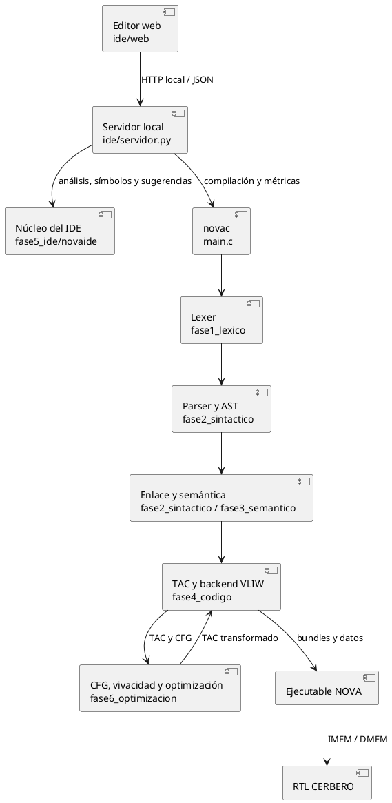
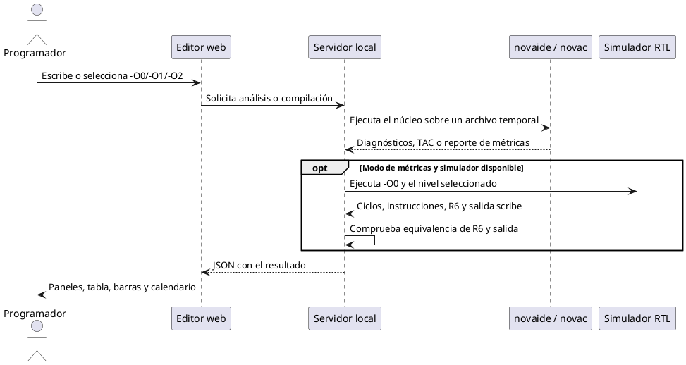
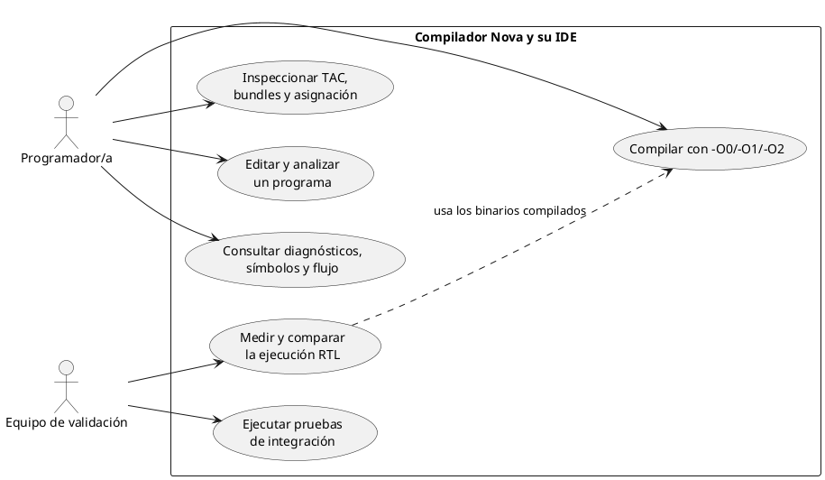

# Guía técnica del compilador Nova

Este documento describe el compilador Nova y la integración que pertenece a
CE1108. El RTL y el contrato ISA son responsabilidad de CE4301; esta guía no
propone cambios a `ARQUITECTURA/`.

## Introducción

Nova es un compilador educativo para el lenguaje Nova y el procesador CERBERO.
El proyecto traduce el fuente a TAC, optimiza el código cuando se solicita y
genera ejecutables con bundles VLIW de cinco slots. Se espera que esta guía
permita explicar su diseño, reproducir su uso y defender con evidencia tanto
las optimizaciones como sus límites.

La separación de responsabilidades es explícita: CE1108 implementa el
compilador y su IDE; CE4301 mantiene el procesador y el ISA. Para CE1108, el
RTL se trata como destino de ejecución y oráculo de integración.

### Fundamentos

El lexer convierte caracteres en tokens; el parser construye el AST y la fase
semántica comprueba declaraciones, tipos y usos. La generación de código baja
el AST a TAC de tres direcciones. El CFG identifica bloques y aristas; la
vivacidad resuelve un punto fijo sobre conjuntos para saber qué valores deben
conservarse. El backend traduce el TAC a bundles VLIW y debe insertar esperas
que respeten las latencias del procesador. Esta separación permite optimizar
sin confundir las reglas del lenguaje con la codificación de CERBERO.

## Ambiente de desarrollo

Registrar las versiones instaladas en la máquina del equipo; no se fijan aquí
porque dependen del entorno de entrega.

| Herramienta | Uso | Versión del equipo |
|---|---|---|
| Compilador C y GNU Make | Compilar `novac` y `novaide`; ejecutar las pruebas | Completar |
| Flex y Bison | Generar lexer y parser durante la compilación | Completar |
| Python 3 | Servidor local del IDE y utilidades de pruebas/integración | Completar |
| Icarus Verilog (`iverilog`, `vvp`) | Ejecutar programas en el RTL y medir ciclos | Completar |
| Navegador web | Usar el editor local en `http://127.0.0.1:8099/` | Completar |
| Git (si se usa en el checkout) | Control de versiones del trabajo | Completar |

Las mediciones de ejecución requieren las herramientas de RTL. El código de
compilación y el tamaño estático se pueden revisar aunque el simulador no esté
instalado.

## Arquitectura

### Diagrama UML de componentes y arquitectura

El compilador transforma un módulo o programa Nova hasta producir un ejecutable
CERBERO. El IDE reutiliza el mismo núcleo C para diagnóstico, navegación y
compilación.



### Flujo del IDE



### Diagrama UML de funcionalidades

Este diagrama de casos de uso delimita las funciones disponibles para quien
programa y para quien valida la entrega:



## Representación y optimización

La representación intermedia es TAC de tres direcciones. El CFG divide las
funciones en bloques básicos; el análisis de vivacidad alimenta la eliminación
de código muerto y la asignación de temporales.

| Nivel | Transformaciones |
|---|---|
| `-O0` | No transforma el TAC; conserva su orden durante la calendarización. |
| `-O1` | DCE, propagación de constantes/copias, plegado y reducción de fuerza. |
| `-O2` | Incluye `-O1` y añade loop unrolling, asignación de temporales a
  registros y reordenamiento seguro por dependencias. |

`--unroll=N` permite solicitar un factor de 1 a 64; si no se da otro nivel,
activa `-O2`. La heurística limita tamaño, alcance de saltos e IMEM. Las
precondiciones y ejemplos se detallan en
[ITERACION4_OPTIMIZACIONES.md](./ITERACION4_OPTIMIZACIONES.md) y
[T2_OPTIMIZACIONES.md](./T2_OPTIMIZACIONES.md).

La asignación usa intervalos de temporales y vivacidad. El pool de temporales
es R2-R5 y R10-R11; R6-R9 permanecen reservados para argumentos y retorno.
Los valores que no pueden ocupar un registro, por presión o por sobrevivir a
una llamada/división que lo destruye, permanecen en slots de pila.
`--asignacion` lista intervalos, registros y derrames.

Las reglas, precondiciones, transformaciones y ejemplos reproducibles de cada
optimización se describen en [T2_OPTIMIZACIONES.md](./T2_OPTIMIZACIONES.md) y
[ITERACION4_OPTIMIZACIONES.md](./ITERACION4_OPTIMIZACIONES.md). Además de las
pasadas por nivel, esa documentación cubre la calendarización VLIW, los stores
locales de índice constante y las llamadas de cola `@cauda`.

## Contrato de ejecución

El backend genera bundles de cinco slots: S0 ALU-0, S1 ALU-1, S2 LSU, S3 CRP y
S4 BRU. Respeta las latencias de tres bundles, las dependencias de registros y
banderas, y el delay slot de cada salto. `--calendario` muestra cada bundle y
la razón de cada NOP.

Las optimizaciones deben preservar el valor de retorno en R6, las escrituras y
la salida de `scribe`, las comprobaciones y los códigos de aborto 134, 136 y
137. Por eso el DCE conserva stores, divisiones, checks y llamadas con efectos,
incluso cuando su resultado no se usa.

## Uso

Desde la raíz del proyecto:

```sh
make
make ide
```

El IDE está disponible en `http://127.0.0.1:8099/`. Seleccione un nivel, elija
«métricas de compilación» y pulse «Compilar» para ver las comparaciones y el
calendario.

Comandos útiles:

```sh
./novac --ir -O1 programa.nv
./novac --ir -O2 programa.nv
./novac --calendario -O2 programa.nv
./novac --asignacion -O2 programa.nv
make metricas F=programa.nv
make metricas-rtl FUENTE_PRUEBA=programa.nv RESULTADO_ESPERADO=25
```

El panel IDE mide ciclos e instrucciones ejecutando el binario en el RTL. Para
la comparación, «Antes» es `-O0` y «Después» es el nivel elegido; antes de
presentar los resultados comprueba que R6 y toda la salida de `scribe`
coincidan. Si faltan `iverilog`, `vvp` o el RTL, el panel explica por qué las
métricas dinámicas no están disponibles. El IPC se calcula como instrucciones
retiradas entre ciclos RTL. Los bytes de código de la comparación estática son
`bundles × 16`; no incluyen el encabezado del ejecutable ni los datos.

## Validación

```sh
make test
make prueba-ide
make prueba-rtl
make prueba-rtl-equivalencia
make metricas-rtl FUENTE_PRUEBA=test/ejecucion/suma_10_15.nv RESULTADO_ESPERADO=25
make depurar F=todo
```

Los casos de optimización cubren tres programas de unrolling, tres de
renombramiento/reutilización de registros, tres de spilling y tres de
reordenamiento con saltos o funciones. También se ejecutan regresiones de DCE
con llamadas y salida observable. Para revisar el RTL de las pruebas nuevas:
[run_rtl.sh](../test/optimizaciones/run_rtl.sh).

## Atributos para el informe

### Conocimiento de ingeniería (CI)

**Pregunta (CI). ¿Cuáles conceptos matemáticos o de ciencias naturales y
fundamentos especializados utilizó en la solución del proyecto? Explique con
detalle y muestre un ejemplo.**

**Respuesta.** Se aplican grafos dirigidos para representar el flujo de control
y las dependencias, conjuntos y punto fijo para el análisis de vivacidad, y
intervalos para asignar temporales a registros sin solapar valores vivos. El
calendarizador usa un grafo de dependencias y latencias de tres bundles para
ubicar operaciones en los cinco slots sin violar el ISA. También se usa
aritmética modular de 32 bits al plegar sumas y multiplicaciones.

Por ejemplo, si `t0 = a + b` y `t1 = c + d` son independientes, el scheduler
puede emitir `t1` mientras espera que el resultado de `t0` esté disponible para
`t2 = t0 * e`. Si además un temporal queda vivo a través de una llamada, no se
lo deja en un registro que la llamada pueda destruir: se conserva en un slot de
pila y se carga en su uso posterior. La comparación RTL mide ciclos e
instrucciones; el número de ciclos no se presenta como una medición de energía.

### Persona ingeniera y el mundo (PM)

**Pregunta 1. Identifique los aspectos sociales, económicos, legales,
ambientales, de seguridad y salud al analizar y evaluar el impacto ambiental
para el desarrollo sostenible al resolver problemas complejos de ingeniería,
específicamente en compiladores.**

**Respuesta.** En lo social, el IDE, sus diagnósticos y sugerencias pueden
reducir barreras de aprendizaje; deben probarse con usuarios y no presentar
advertencias engañosas. En lo económico, menos bundles o ciclos puede reducir
tiempo de ejecución y costo, pero el esfuerzo de desarrollo, las plataformas y
el costo de validación también cuentan. En lo legal, deben respetarse licencias
de dependencias y atribuirse correctamente el código reutilizado. En lo
ambiental, una menor cantidad de instrucciones puede reducir trabajo, pero no
demuestra por sí sola menor consumo eléctrico ni impacto de ciclo de vida. En
seguridad y salud, una transformación incorrecta puede producir resultados
erróneos, escrituras indebidas o abortos diferentes; las pruebas verifican
R6, la salida de `scribe` y los abortos contractuales. Este compilador no se
presenta como certificado para sistemas críticos ni incluye una medición física
de potencia.

**Pregunta 2. Explique la importancia de los aspectos sociales, económicos,
legales, ambientales, de seguridad y salud en el análisis y evaluación del
impacto ambiental para el desarrollo sostenible al resolver problemas
complejos de ingeniería.**

**Respuesta.** Considerarlos evita optimizar un indicador aislado a costa de
la corrección, la accesibilidad, el cumplimiento legal o costos trasladados a
otras etapas del ciclo de vida. Separar métricas observadas de hipótesis
ambientales permite que docentes, usuarios y responsables de despliegue evalúen
beneficios y riesgos con evidencia comparable.

**Pregunta 3. Explique cómo integrar los aspectos sociales, económicos,
legales, ambientales, de seguridad y salud en el análisis y evaluación del
impacto ambiental para el desarrollo sostenible al resolver problemas
complejos de ingeniería.**

**Respuesta.** Se comparan `-O0` y el nivel optimizado en el RTL y solo se
reportan resultados equivalentes cuando coinciden R6 y toda la salida de
`scribe`. Se conservan los stores, checks, divisiones y llamadas con efectos,
incluidos los códigos de aborto 134, 136 y 137. Para sostenibilidad se reportan
ciclos e instrucciones como indicadores de actividad, sin convertirlos en
watts ni CO2; una afirmación energética futura requeriría medición de potencia
con una metodología y plataforma descritas. Se documentan licencias y
dependencias, y se mantiene el IDE local para que el fuente no necesite
enviarse a un servicio remoto.

## Bitácora de actividades y horas

Duplicar esta plantilla para cada estudiante. Registrar actividades y horas
verificadas (no estimadas); adjuntar o enlazar evidencia cuando exista. El
responsable completa nombres, fechas y totales antes de la entrega.

**Estudiante:** ____________________  **Identificación:** ________________

| Fecha / período | Actividad realizada | Evidencia o entregable | Horas |
|---|---|---|---:|
| Completar | Completar | Completar |  |
| Completar | Completar | Completar |  |
| Completar | Completar | Completar |  |
| Completar | Completar | Completar |  |
| **Total del estudiante** |  |  | **Completar** |

## Conclusiones

El proyecto integra análisis de fuente, TAC, optimizaciones y ejecución
CERBERO en una cadena reproducible. El análisis de vivacidad sostiene tanto la
eliminación de código muerto como la asignación de temporales; el scheduler
reduce esperas respetando dependencias y latencias del ISA. La evidencia de
equivalencia en RTL respalda la preservación de R6 y `scribe`, mientras que las
métricas dinámicas describen ciclos e instrucciones, no energía física.

La principal limitación es que el reordenamiento y la asignación usan
aproximaciones conservadoras, y el análisis de alias no permite eliminar
stores. Los factores de unrolling están limitados para controlar el tamaño y
el alcance de saltos.

## Sugerencias y recomendaciones

- Ejecutar `make test`, `make prueba-ide` y `make prueba-rtl` después de cambios
  al compilador; agregar regresiones de equivalencia para toda nueva regla.
- Comparar niveles sobre programas representativos y publicar tanto mejoras
  como regresiones, tamaño del binario y configuración del RTL.
- No afirmar ahorro energético a partir de ciclos únicamente; medir potencia
  en hardware y declarar plataforma, carga y método antes de cuantificarlo.
- Mantener los límites de CE1108 y CE4301 separados y verificar el contrato ISA
  sin modificar los fuentes de `ARQUITECTURA/`.
- Completar la bitácora por integrante y verificar la procedencia y licencia
  de dependencias antes de entregar.

## Referencias del proyecto

1. [Especificación del Proyecto II](../ESPECIFICACION_PROYECTO2.txt), en
   particular las secciones 4, 6, 7.2, 7.3, 8.2 y 9.2.
2. [Contrato ISA CERBERO](../ARQUITECTURA/docs/isa.md).
3. [T2: DCE, propagación y reducción de fuerza](./T2_OPTIMIZACIONES.md).
4. [Iteración 4: loop unrolling y spilling](./ITERACION4_OPTIMIZACIONES.md).
5. [Guion de pruebas del IDE](./PRUEBAS_IDE.md).
6. Aho, A. V., Lam, M. S., Sethi, R. y Ullman, J. D. *Compilers: Principles,
   Techniques, and Tools*, 2.ª edición, Pearson, 2006.
7. Cooper, K. D. y Torczon, L. *Engineering a Compiler*, 2.ª edición, Morgan
   Kaufmann, 2011.
8. Naciones Unidas. *Transformar nuestro mundo: la Agenda 2030 para el
   Desarrollo Sostenible*, A/RES/70/1, 2015.
